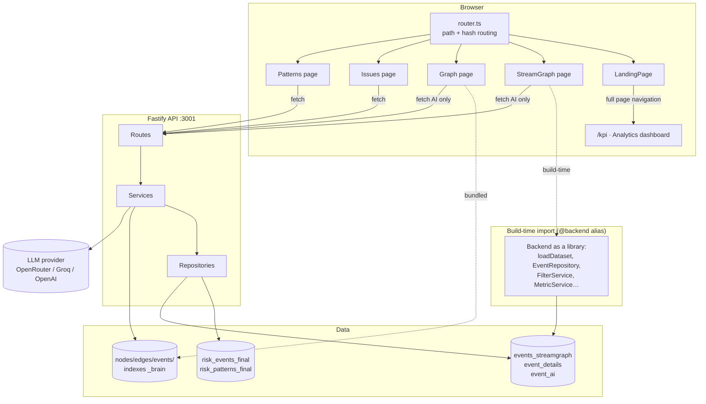

# Architecture at a glance

An npm-workspaces monorepo with four packages: two Vite frontends and two
Fastify APIs. The exploration backend also supplies the shared TypeScript
library imported by the exploration frontend through its `@backend` alias.
The executive frontend serves `/kpi`; the exploration frontend serves the
workspace and the other analysis screens. The local gateway and deployment
rewrites route requests to the appropriate API.

**Two data-delivery strategies, on purpose:**

| Strategy | Used by | Why |
| --- | --- | --- |
| **Build-time embedding** (JSON imported into the bundle) | Streamgraph, Relationship Network | These are visual explorers over a fixed dataset. Embedding makes them work from a single static HTML file — even `file://` — with zero API dependency. |
| **Runtime HTTP fetch** | Analytics dashboard, Issue Intelligence, Pattern Intelligence | Their content is *derived* (ranking, signals, comparisons) and computed once at server startup. Serving it keeps ranking logic and thresholds server-side and out of the client bundle. |

Repository layout: [repository-layout.md](repository-layout.md).

---

[← Docs index](README.md) · [Project README](../README.md)
